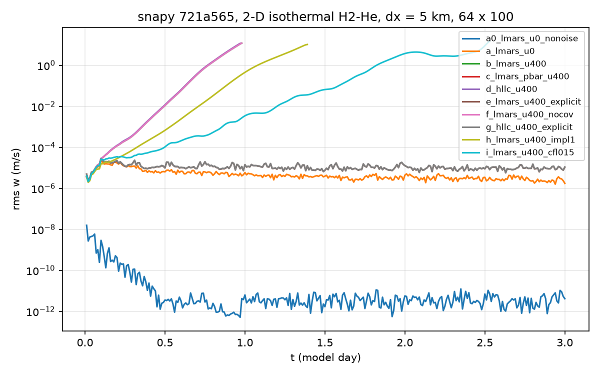

# LMARS energy-flux stability test: independent reproduction

This is the independent leg of Xi's test: is the LMARS energy flux
(`src/riemann/lmars_impl.h:61/76`, `F_E = u* (rho h)_upwind`, while the
momentum flux at `:58/:73` uses the face pressure `pbar`) unstable under a
strong uniform horizontal wind? The deck and scripts here were written from
the spec alone and do not reuse the other leg's files.

## Code under test

snapy `main` was pinned with `git ls-remote https://github.com/chengcli/snapy refs/heads/main`
at `721a5654ad3cf48543226a76ef8b0be6ad1fc7ad` ("Add cubed sphere diffusion (#324)").
Its parent is `a09cc25` (the sha Xi cites). `git diff --stat a09cc25 721a565 -- src/riemann`
is empty. This branch is based on that sha.

`src/riemann/lmars_impl.h` at `721a5654ad3cf48543226a76ef8b0be6ad1fc7ad`:

```
58:    FLX(ivx) = ubar * wli[IDN] * wli[IVX] + pbar;
61:    FLX(IPR) = ubar * wli[IDN] * hl;
73:    FLX(ivx) = ubar * wri[IDN] * wri[IVX] + pbar;
76:    FLX(IPR) = ubar * wri[IDN] * hr;
```

At lines 28-31, `hl/hr` become `e + KE + p/rho` of the upwind side, so the
energy flux's pressure work is `u* p_upwind`. The momentum flux carries `pbar`
(line 38). This matches the description.

`lmars-energy-flux-pbar.patch` is the break test. It sets the pressure work to
`u* pbar` (`FLX(IPR) = ubar * (rho h - p + pbar)` on both branches). It is applied
only in a separate worktree for arm (c). The code on this branch is unmodified main.

## Setup (`deck.yaml`, `run_arm.py`)

- 2-D Cartesian. x1 is vertical: 0 to 450 km, 100 cells, dz = 4.5 km, reflecting walls.
  x2 is horizontal and periodic: **64 columns** at dx = 5 km (320 km). nx3 = 1.
  No rotation.
- Dry H2-He ideal gas: R = Rgas/2.3e-3 = 3615 J/(kg K), gamma = 1.4. g = 8.87.
- Isothermal T0 = 100 K, with a bottom-cell p of 1e6 Pa before balancing. The column
  is projected onto snapy's own discrete hydrostatic balance with
  `snapy.balance_column` (T fixed). Residual 5.27e-11 after 24 sweeps.
- weno5 (scale on, shock off) in both directions, rk3, cfl 0.3, implicit-scheme 9.
  Other settings are snapy defaults (gravity-work face, flux covariance on).
- Noise: Gaussian white noise in T with std 1e-6 K, at fixed p (rho rescaled), on
  interior cells. `torch.Generator().manual_seed(20261025)`.
- Uniform wind u in x2. Diagnostics every 864 s: rms and max |w| over the interior,
  rms(u - U), and w(x2) on the mid-height row (z = 227.25 km). A run stops early once
  max |w| > 50 m/s ("blew up").

## Commands

```bash
# environment: Python 3.11 venv (the login Python has no torch)
python3.11 -m venv $VENV
$VENV/bin/pip install "torch==2.10.0" "kintera>=2.6.3" numpy commux pinc pyyaml scipy netCDF4 matplotlib wheel "setuptools>=70"

# source builds, CPU only (gcc-toolset-13; README steps 4-5)
git clone https://github.com/chengcli/snapy && cd snapy && git checkout 721a5654ad3cf48543226a76ef8b0be6ad1fc7ad
git worktree add ../snapy-pbar HEAD && (cd ../snapy-pbar && git apply $T/lmars-energy-flux-pbar.patch)
VENV=$VENV $T/build.sh $PWD 12 && VENV=$VENV $T/build.sh ../snapy-pbar 12
pip install --no-build-isolation --no-deps --target $W/site-main .
(cd ../snapy-pbar && pip install --no-build-isolation --no-deps --target $W/site-pbar .)

# runs (each single process; arms in parallel)
cd $W && source $VENV/bin/activate
$T/run_all.sh site-main site-pbar runs            # all arms; ONLY=abd|c|ef|gh|i selects groups
python $T/analyze.py runs/<arm> ... > results.md   # tables, fits, FFT wavelength
python $T/plot.py runs/* -o rms_w.png
```

Here `$T` is this directory and `$W` is a scratch directory. Versions used: Python 3.11.13,
torch 2.10.0, kintera 2.6.6, commux 0.2.1, pinc 0.2.0, numpy 2.4.6, gcc 13
(gcc-toolset-13), CMake 3.26.5. snapy is the source build of 721a565 above, not the PyPI wheel.

## Results

The full tables (rms w every 0.1 day, max |w|, rms(u-U)) are in `results/results.md`.
The raw logs are in `results/raw/` (gzip jsonl plus meta.json per arm). Fits are least
squares of ln(rms w) against t: over [0.25 d, end], and over the steepest 0.5-day window.
The wavelength is the peak of |FFT| of the mid-height w row (k = 0 excluded).



(e) and (g) overlap in the figure. (b), (c), (d) and (f) overlap too.

| arm | solver | u (m/s) | vertical | other | outcome | max abs w (m/s) | ln(rms w) slope, 0.25 d to end | steepest 0.5-d window | dominant lambda (dx) |
|---|---|---|---|---|---|---|---|---|---|
| a0 | lmars | 0 | impl 9 | no noise | 3 d ok | 3.9e-8 (t=0.01 d) | -0.23/d (R^2 0.04) | none | n/a (rms w 4.1e-12 at 3 d) |
| a | lmars | 0 | impl 9 | | 3 d ok | 2.0e-4 (t=0.22 d) | -0.41/d (R^2 0.68) | none | 64 (end), 8 (rms peak) |
| b | lmars | 400 | impl 9 | | blew up at 0.98 d | 58.5 | 15.8/d (R^2 0.996) | 16.9/d on [0.27, 0.77] d (R^2 1.000) | 10.7 (k=6) |
| c | lmars + u* pbar patch | 400 | impl 9 | break test | blew up at 0.97 d | 51.0 | 15.9/d (R^2 0.996) | 17.0/d on [0.27, 0.77] d (R^2 1.000) | 10.7 (k=6) |
| d | hllc | 400 | impl 9 | | blew up at 0.97 d | 57.4 | 15.8/d (R^2 0.997) | 16.9/d on [0.27, 0.77] d (R^2 1.000) | 10.7 (k=6) |
| e | lmars | 400 | explicit | implicit-scheme 0 | 3 d ok | 2.0e-4 (t=0.10 d) | -0.12/d (R^2 0.15) | none | 21.3 (k=3) |
| f | lmars | 400 | impl 9 | SNAP_FLUX_COVARIANCE=0 | blew up at 0.98 d | 58.5 | 15.8/d (R^2 0.996) | 16.9/d on [0.27, 0.77] d (R^2 1.000) | 10.7 (k=6) |
| g | hllc | 400 | explicit | implicit-scheme 0 | 3 d ok | 2.0e-4 (t=0.10 d) | -0.11/d (R^2 0.14) | none | 21.3 (k=3) |
| h | lmars | 400 | impl 1 | partial implicit | blew up at 1.39 d | 50.9 | 11.5/d (R^2 0.993) | 13.2/d on [0.50, 1.00] d (R^2 1.000) | 10.7 (k=6) |
| i | lmars | 400 | impl 9 | cfl 0.15 | blew up at 2.53 d | 61.7 | 6.0/d (R^2 0.978) | 8.9/d on [1.51, 2.01] d (R^2 0.997) | 12.8 (k=5) |

The "steepest window" column reads "none" where the best 0.5-day fit has R^2 < 0.5
(a0: 3.3/d with R^2 0.41, the recovery from a dip near 0.95 d; a, e, g: 0.4 to 0.46/d with
R^2 at most 0.1), which is fluctuation rather than growth. The raw values are in `results/results.md`.
Arms (e) through (i) go beyond the brief. I added them as diagnostics once (d) grew.
In (b) and (f), rms w agrees to about 2e-8 relative at 0.5 d
(0.0109065970 vs 0.0109065972), so the covariance correction does nothing here. In (b) and (c),
rms w first differs at t = 865 s (3.61808e-6 vs 3.61847e-6), which confirms the patched kernel was in use.
The patched and unpatched `libsnap_release.so` have different md5s.

## Verdict

1. **Control (a):** the u = 0 arm passes. With no noise (a0), rms w peaks at 1.6e-8 m/s
   at 0.01 d and decays to about 4e-12 m/s (round-off) by 0.5 d, where it stays through 3 d.
   The initial 1e-8 is the size that a 5.3e-11 g balance residual can drive.
   That is a hypothesis: it is consistent in magnitude, but I did not isolate it.
   With 1e-6 K noise (a), rms w stays flat at about 2e-6 to 2e-5 m/s for 3 days, with no growth.
2. **(b) grows exponentially:** 16.9 per day (e-folding about 1.4 h) at a dominant
   wavelength of 10.7 dx (k = 6 of 64, 53 km). It reaches max |w| > 50 m/s at 0.98 d.
3. **The break test (c) does not remove it.** The growth rate (17.0 per day), wavelength
   and blow-up time match (b). So the u* (rho h)_upwind pressure work is **not** the cause
   in this setup.
4. **HLLC (d) grows identically** (16.9 per day, 10.7 dx), so the growth is not LMARS-specific.
5. **What does remove it (beyond the brief):** explicit vertical stepping. With
   implicit-scheme 0, LMARS (e) and HLLC (g) at u = 400 both stay at the noise level for
   3 days (rms w about 1e-5 m/s, max |w| 2.0e-4 m/s). The partial implicit scheme 1 (h) also
   grows (13.2 per day). Halving cfl with scheme 9 (i) slows the growth to 8.9 per day but
   does not stop it. The flux covariance switch (f) has no effect.
   Hypothesis (not tested further): the vertical implicit solve combined with a strong uniform
   horizontal wind gives a time-step-dependent instability at about 10 dx, independent of
   the Riemann solver. I did not run the u and dx sweeps that would show its scaling.
   Those are in the other leg's 24 arms.
